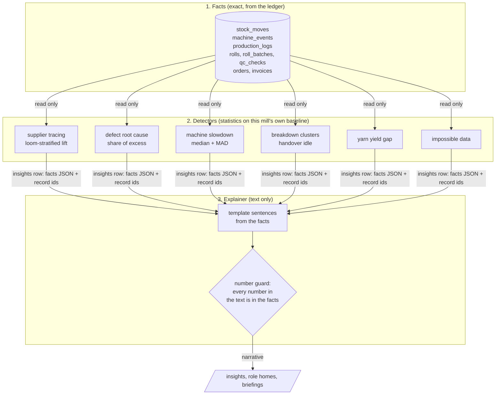

# AI layer

Local, honest, useful. It reads the mill's own records on the mill's own server, works with the
internet off, and never invents a number. Owner: Muaz. Code: `backend/app/modules/analytics/`.

## Three layers

1. **Facts.** Exact numbers from the ledger and event tables. The AI layer only reads them; it
   writes nothing but its own `insights` rows and `audit_log` rows.
2. **Detectors.** Plain statistics that learn each machine's, supplier's and shift's normal from
   this mill's own rows. Nothing is pretrained on outside data. Each detector returns findings
   with a `facts` JSON: the numbers people see plus `records` (type, id, code) behind them.
3. **Explainer.** Turns one finding's facts into two or three plain sentences. Today it uses fixed
   templates (no language model). `numbers_ok()` checks that every number in a sentence appears
   in the facts; tests run it over every template. A local model (for example through Ollama) can
   later replace `narrate()` in `explainer.py` and must pass the same guard, with the template as
   fallback.

## Detectors

| Kind | Question | Method | Who sees it |
|---|---|---|---|
| `supplier_defects` | Is one supplier's yarn causing defects? | First QC attempt per roll, supplier from `roll_batches → yarn_batches`. Expected defects = Σ per loom (supplier's rolls on that loom × other suppliers' rate on that same loom). Lift = observed ÷ expected. Flag lift ≥ 1.8 with ≥ 30 rolls, ≥ 8 defective. Also quarantine and short-delivery rate at the gate vs other suppliers. | store, qc |
| `defect_root_cause` | Defects rose this week. Why? | Last 7 days vs the 21 before. If the rate is ≥ 1.3× and ≥ 5 extra defective rolls: for every loom, shift, weaver, yarn lot, supplier and fabric, share of the extra defects and lift vs the other rolls. Top 3. | qc, supervisor |
| `machine_slowdown` | Is a machine slowly getting slower? | Daily output per running hour. Baseline = the machine's own median; spread = MAD × 1.4826. Flag 3+ days in a row at robust z ≤ −3. Links a breakdown that follows. | supervisor |
| `breakdown_cluster` | Are breakdowns repeating? | Last 7 days: ≥ 4 on one machine, ≥ 4 with the same reason on 2+ machines, or ≥ 8 in one shift (≥ 60 %, over 3+ days). | supervisor |
| `shift_change_idle` | Is one handover slow? | Idle stops starting within 15 min of a shift start. Flag the handover whose median is ≥ 20 min and ≥ 2× the other handovers. | supervisor |
| `yarn_yield_gap` | Where does yarn disappear? | Finished weaving jobs: kg issued (issue − return moves) vs `yarn_kg_for_fabric(metres woven)` with the fabric's process loss. Flag > 3 % and ≥ 5 kg, per order and per loom, valued at GRN cost. | store, supervisor |
| `impossible_data` | Which records cannot all be true? | Output stamped inside a breakdown or maintenance window; more metres cut from a job than logged on it; a receipt over 3× or under ⅓ of the supplier's median lot. | supervisor |

Thresholds are constants at the top of each section in `detectors.py`.

## Insights lifecycle

- One live insight per finding: `kind + entity + facts.key`. A second run updates it in place
  (facts, severity, text). The key carries what makes a finding new: the defect type, the
  slowdown's first day, the ISO week for clusters.
- `open → acknowledged → resolved`, through `check_transition`, each with a required note written
  to `audit_log`. A resolved finding with the same key stays quiet.
- Runs: every 5 minutes in the background (router lifespan in `worker.py`) and on demand
  (`POST /api/analytics/run`, the "Run detectors now" button). A Postgres advisory lock makes
  overlapping runs wait instead of creating duplicates.

## Delivery forecast (not AI, a schedule)

`delivery_estimate(order_id)` simulates the floor: machines in a min-heap keyed by when each is
free, unfinished work orders taken earliest-deadline-first, remaining work ÷ the machine's median
throughput of its last 6 shifts. Plus 8 h QC and 24 h dispatch allowance. Status against the end
of the deadline day: `late`, `at_risk` (< 24 h slack), `on_track`. The response carries the basis
(machines, speeds, windows, allowances) and the UI shows it under "how calculated".

A breakdown or QC event makes `worker.py` publish one debounced `orders` event, so every open
delivery view refetches its forecast.

## Offline

Nothing here calls the internet. Stats use the Python standard library (`statistics`, `heapq`,
`bisect`). No model is downloaded or called today.

## How we know it works

`make evaluate` runs the detectors on a simulated month with five planted problems and writes
precision and recall to [ai-evaluation.md](ai-evaluation.md). It is simulated data, and we say so.
