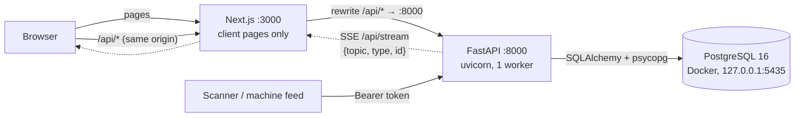
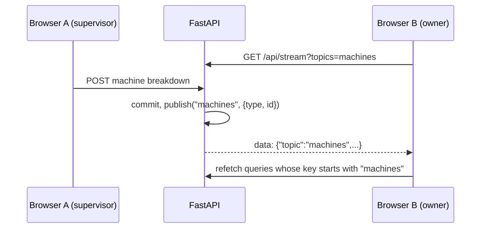

# Architecture

Three processes, all on one machine. Nothing leaves localhost.



- Next serves the UI and proxies every `/api/*` call to FastAPI (`frontend/next.config.ts`). The
  browser sees one origin: no CORS, and the httpOnly auth cookie works without extra setup.
- Next never talks to the DB. No server actions, no Next API routes.
- `frontend/src/middleware.ts` sends a visitor with no `access_token` cookie to `/login`. That is
  only a convenience. FastAPI checks the token on every call.

## Backend layers

```
router.py   HTTP only: parse input (Pydantic schema), check role, call service, return schema
service.py  business rules, status transitions, audit row, commit, then publish event
models.py   SQLAlchemy tables and DB constraints
```

One write request, end to end:

1. Router validates the body with a Pydantic schema. Bad input: 422 with `field`.
2. `require_roles(...)` checks the role. Wrong role: 403. Owner passes every check.
3. Service checks business rules and `check_transition()` for status changes. Illegal: 409.
4. Service writes rows and an `audit_log` row in the same transaction, then `db.commit()`.
5. DB constraints are the last guard. Unique clash: 409. CHECK or FK: 422.
6. After commit, service calls `events.publish(topic, {...})`.
7. Every error leaves in one shape: `{"error": {"code", "message", "field"}}`.

Shared services (called by other modules) never commit. The caller owns the transaction. See
[contracts.md](contracts.md).

## Live updates (SSE)



- The event carries no data, only "topic changed". The browser refetches through the normal API,
  so role checks still apply.
- Topics: `stock`, `machines`, `orders`, `quality`, `dispatch`, `insights`.
- Query-key rule: the first element of every TanStack Query key is its topic or module name,
  for example `["machines", "board"]`. `useSSE()` in `frontend/src/lib/useSSE.ts` invalidates by
  that prefix.
- Fan-out is in-process (`backend/app/core/events.py`). This needs one uvicorn worker. For more
  workers, switch to Postgres `LISTEN/NOTIFY`.

## Frontend

- `src/nav.ts` lists every route with its roles and owner. It drives the sidebar, breadcrumbs and
  the page guard in `src/components/layout/AppShell.tsx`.
- `src/lib/api.ts` is the one fetch wrapper. It turns the error shape into `ApiError` and sends a
  401 to `/login`.
- `src/components/layout/` holds `AppShell`, `Sidebar`, `PageHeader`, `DataTable` (loading, empty,
  error, pagination), `FormField` (inline server field errors), `StatusBadge`, `EmptyState`.
- Design tokens live in `src/app/globals.css` only. Light and dark follow the OS setting.

## Offline

Postgres runs in a local container. Fonts are the system stack and icons are bundled. Nothing
calls an external service at runtime.
