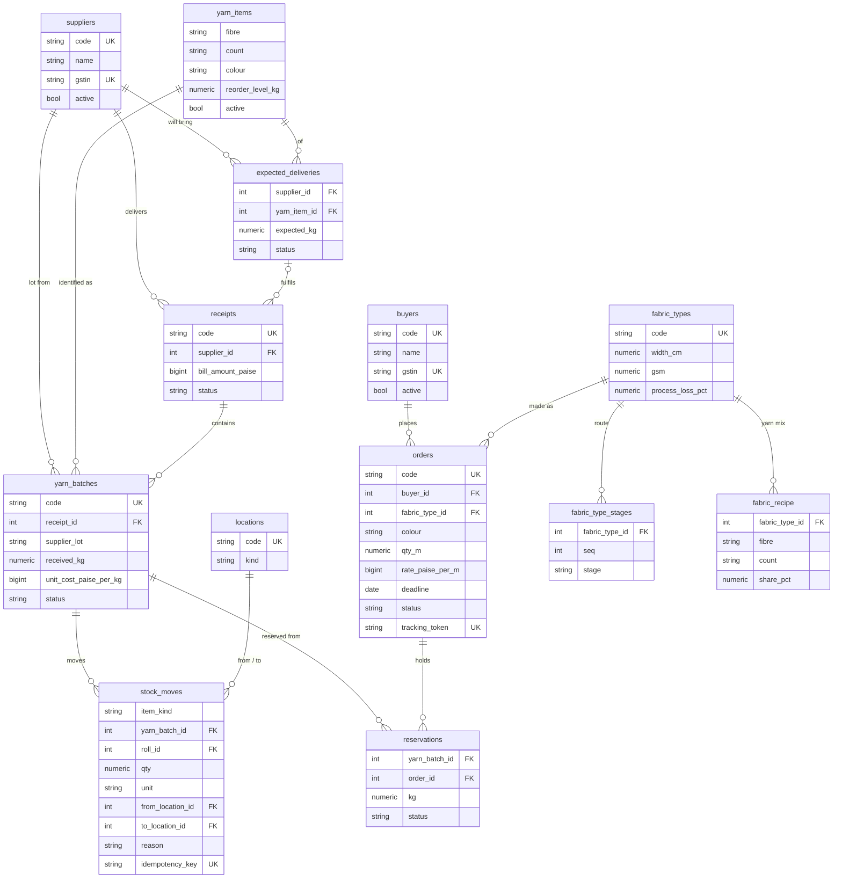
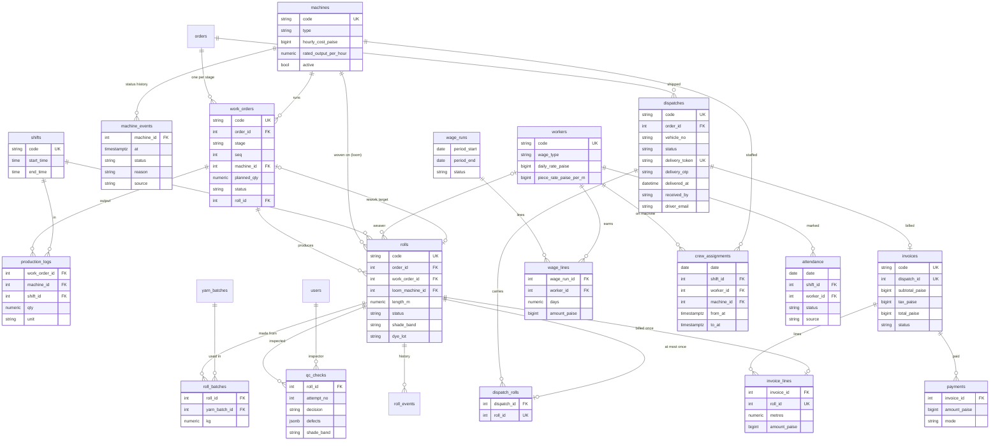

# ER diagram (schema v1)

Source of truth: `backend/app/modules/*/models.py` and `backend/alembic/versions/0001_schema_v1.py`.
Every table also has `id` (identity PK) and `created_at` (timestamptz). Status columns are
VARCHAR with a CHECK constraint. Money is BIGINT paise. Quantities are NUMERIC(12,3).

## Masters, stock, orders

## Production, quality, dispatch, finance, workforce

## System tables

| Table | Purpose |
|---|---|
| `users` | Login. `email` unique, bcrypt `password_hash`, `role`, `active`. |
| `audit_log` | Who did what to which record. Written in the same transaction as the change. |
| `code_sequences` | Next number per code prefix (`YB`, `RC`, `SO`, `WO`, `R`, `DN`, `INV`). |
| `idempotency_keys` | Stored response per key, so a repeated scan does not double-post. |
| `insights` | Computed findings (analytics). `facts` JSONB holds the numbers. |
| `expenses` | Power, maintenance, transport, rent, other. For month-end profit. |

## Constraints worth knowing

- `dispatch_rolls.roll_id` UNIQUE: a roll goes on one dispatch, ever (R18).
- `invoices.dispatch_id` UNIQUE and `invoice_lines.roll_id` UNIQUE: one invoice per dispatch, a roll is billed once.
- Partial UNIQUE `work_orders(machine_id) WHERE status = 'running'`: one running job per machine.
- Partial UNIQUE `work_orders(order_id, seq) WHERE roll_id IS NULL`: one work order per stage per order.
- `stock_moves.item_matches_kind`: yarn moves in kg with a batch, fabric moves in metres with a roll.
- `stock_moves.moves_somewhere`: from and to locations differ.
- `qc_checks.pass_has_shade`: a passed roll must have a shade band.
- `machine_events.downtime_has_reason`: breakdown and maintenance need a reason.
- `workers.rate_matches_wage_type`: daily workers need a daily rate, piece workers a piece rate.
- `invoices.total_adds_up`: total = subtotal + tax.
