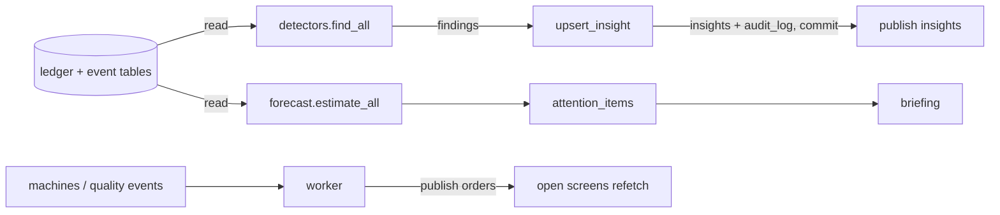

# Analytics module

Owner: Muaz. Code: `backend/app/modules/analytics/`, `frontend/src/features/analytics/`, pages
`/owner`, `/insights`, and the briefing and attention list on `/floor`. Requirements D2 (delivery
risk), R13 support (defect analysis), the AI layer. Design of the AI layer: [../ai.md](../ai.md).

## What it does

- **Delivery forecast** per confirmed order, with status and the basis it was worked out from.
- **Attention list** per role: the few things that role should act on now, each linking to its
  record. **Briefing**: the same list in two or three sentences.
- **Detectors** that find problems in the mill's own records and store them as insights.
- **Insights screen**: list by severity, filters, detail with text, facts and record links,
  acknowledge and resolve with a note.

## Files

| File | Job |
|---|---|
| `forecast.py` | throughput per machine, the EDF + min-heap schedule, status vs deadline |
| `detectors.py` | data loaders (read only) and pure statistics, one section per detector |
| `explainer.py` | template sentences, the number guard, the briefing text |
| `service.py` | insight upsert, list, status changes, attention rules, shared services |
| `worker.py` | background detector loop, forecast refresh on floor events |
| `router.py`, `schemas.py` | HTTP and Pydantic |

## Data flow

## Endpoints

| Route | Who | What |
|---|---|---|
| `GET /api/analytics/insights?status&severity&kind` | any logged in | paged, worst first; each role sees only the kinds it acts on, owner sees all |
| `GET /api/analytics/insights/{id}` | any logged in | one finding (404 if not your kind) |
| `POST /api/analytics/insights/{id}/acknowledge` `{note}` | any logged in, own kinds | open → acknowledged |
| `POST /api/analytics/insights/{id}/resolve` `{note}` | any logged in, own kinds | open or acknowledged → resolved |
| `POST /api/analytics/run` | supervisor | run all detectors now; returns created/updated/unchanged/skipped |
| `GET /api/analytics/attention` | any logged in | the caller role's to-do list (max 12) |
| `GET /api/analytics/briefing` | any logged in | that list in sentences |
| `GET /api/analytics/delivery` | accounts, supervisor | every confirmed order's forecast, worst first |
| `GET /api/analytics/orders/{id}/delivery-estimate` | accounts, supervisor | one order; 409 `not_forecastable` if not confirmed |

Shared services (never commit): `delivery_estimate(db, order_id)`, `attention_items(db, role)`.

Drop-ins for other owners' screens: `AttentionList` and `BriefingCard`
(`features/analytics/AttentionList.tsx`) for any role home, `DeliveryEstimateCard`
(`features/analytics/Delivery.tsx`) for the order page.

## Invariants and how each is enforced

| Rule | Where |
|---|---|
| Analytics never writes another module's tables | loaders only `select`; the only writes are `insights` and `audit_log` |
| One live insight per finding | `upsert_insight` matches `kind + entity + facts.key` and updates in place |
| Two runs at once never duplicate | `pg_advisory_xact_lock` at the start of `run_detectors` |
| A resolved finding is not raised again | `upsert_insight` returns `skipped` when the same key is resolved |
| Insight status only along the map | `check_transition(INSIGHT_TRANSITIONS, ...)`, 409 `illegal_transition` |
| Acknowledge and resolve need a reason | `NoteIn.note` (stripped, 1–2000 chars, 422), stored in `audit_log.reason` |
| A role sees only its kinds | `KIND_ROLES` filter on list and detail (404, so ids do not leak) |
| Text never states a number that is not in the facts | templates read only `facts`; `numbers_ok()` checked by tests over every template |
| A screen never waits on a model | no model; text is built in the same transaction as the insight |
| Forecasts are never stale | computed on read; floor events trigger a refetch via SSE |
| Shared services never commit | `delivery_estimate`, `attention_items` only read |

## DSA used and why

- **Min-heap (priority queue) of machines keyed by free time** (`heapq`) with jobs taken
  **earliest deadline first**. Each assignment is O(log m). It is greedy, not optimal, but it is
  how a supervisor plans and it is explainable line by line.
- **Median and MAD** (median absolute deviation) for machine baselines. A mean and standard
  deviation get dragged by breakdown days; the median ignores them. Robust z = (x − median) ÷
  (1.4826 × MAD).
- **Run-length scan** over daily z-scores: a slowdown is 3+ days in a row below −3, so one bad day
  does not alarm.
- **Stratification (like a Mantel-Haenszel expected count)** for suppliers: compare inside each
  loom, then add up. A bad loom cannot make a good supplier look bad.
- **Share of excess** for root cause: of the extra defective rolls this week, what part sits on
  each candidate. Ranks the cause that explains the most, not only the one with the highest rate.
- **Binary search** (`bisect`) to find which downtime window an output log falls in.
- **Hash maps** (`defaultdict`, `Counter`) for grouping; every detector is one pass over its rows.

## Questions an evaluator is likely to ask

1. **Is this real AI or a filter?** Statistics, not a model: the detectors learn each machine's
   and supplier's normal from this mill's data and flag what is far from it. We call the forecast
   a schedule, not AI. No language model is used yet; the text comes from templates.
2. **How do you know the detectors work without real data?** `make evaluate` simulates 30 days
   with five planted problems and scores the detectors: 5 of 5 found, no false alarms
   (`docs/ai-evaluation.md`). We say openly that it is simulated.
3. **Why blame SLY and not the loom?** The comparison is inside each loom: SLY's rolls are compared
   with other suppliers' rolls woven on the same loom, then summed. On the simulated month that is
   43 defective against 15.5 expected, 2.8×.
4. **How is the delivery date worked out?** Remaining metres ÷ each machine's median output per
   running hour over its last 6 shifts, machines taken earliest-free, orders earliest-deadline
   first, plus QC and dispatch allowance. The order row expands to show every number used.
5. **What stops the same problem appearing twenty times?** One live insight per finding key,
   updated in place, an advisory lock around runs, and resolved findings stay quiet.
