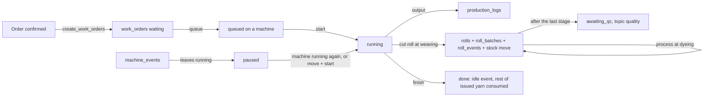

# Production module

Owner: Muaz. Code: `backend/app/modules/production/`, `frontend/src/features/production/`,
pages under `frontend/src/app/(app)/floor/`. Requirements R6, R7, R8, R9 (machines, jobs,
live board, breakdowns).

## What it does

- Turns an order into one work order per route stage (`create_work_orders`).
- Lets the supervisor queue work orders on machines, reorder a queue, start, move and finish jobs.
- Takes machine status events and output logs from three tiers through one intake: tablet
  (`manual`), barcode scanner (`scanner`) and machine counter (`machine`).
- Gives every woven roll an identity at the loom, with yarn lineage, and walks it through later
  stages (dyeing) to the QC queue.
- Shows every machine live on the floor board (`/floor`).

## Data flow

Every write: router validates (Pydantic) → `require_roles(supervisor)` (owner passes) → service
checks rules and transition map → rows + `audit_log` in one transaction → commit →
`events.publish("machines", ...)` (plus `quality` for rolls waiting for QC and `orders` for
progress).

## Endpoints

| Route | Who | What |
|---|---|---|
| `GET /api/production/board` | any logged in | one tile per machine: status, since, reason, job, progress, today's output, crew |
| `GET /api/production/machines/{id}/timeline?date=` | any logged in | events of that IST day, seconds per status, output logs |
| `GET /api/production/work-orders` | any logged in | paged list, filters `status`, `order_id`, `machine_id` |
| `GET /api/production/work-orders/open` | any logged in | every open job with order code, deadline and produced qty |
| `POST /api/production/work-orders/{id}/queue` `{machine_id}` | supervisor | waiting → queued, last in line |
| `POST /api/production/work-orders/{id}/unqueue` | supervisor | queued → waiting |
| `PUT /api/production/machines/{id}/queue` `{work_order_ids}` | supervisor | new queue order |
| `POST /api/production/work-orders/{id}/start` | supervisor | queued or paused → running |
| `POST /api/production/work-orders/{id}/move` `{machine_id, reason}` | supervisor | queued or paused job to another machine |
| `POST /api/production/work-orders/{id}/finish` | supervisor | running → done |
| `POST /api/production/machine-events` | supervisor (machine feeds log in as one) | new machine status |
| `POST /api/production/output` | supervisor | output against machine (+ job, shift, worker derived) |
| `POST /api/production/rolls` | supervisor | cut a roll off a loom |
| `POST /api/production/rolls/{id}/process` `{work_order_id}` | supervisor | roll went through dyeing or rework |

Shared services (never commit): `create_work_orders`, `machine_status`, `order_progress`,
`create_rework_work_order`. See `docs/contracts.md`.

## Invariants and how each is enforced

| Rule | Where |
|---|---|
| Status changes only along the map (work order, roll) | `check_transition` in the service, 409 `illegal_transition` |
| A machine status is a fact: any change allowed, repeating the current one is 409 | `MACHINE_TRANSITIONS` |
| Breakdown and maintenance need a reason | Pydantic validator (422 on `reason`), service check, DB CHECK `downtime_has_reason` |
| One running job per machine | service check, DB partial unique index `uq_work_orders_one_running_per_machine` |
| A running job has a machine | DB CHECK `running_has_machine` |
| A job runs only while its machine runs | `_set_machine_status`: leaving `running` pauses the job, coming back resumes it |
| A broken machine takes no new job and no output | `_usable_machine` and `log_output`, 409 `machine_down` |
| Job goes only to a machine of its stage | `_usable_machine`, 409 on `machine_id` |
| Only confirmed orders get queued | `queue_work_order` |
| Queue reorder uses the exact current queue | `reorder_queue` locks rows `FOR UPDATE`, rejects a stale id set with 409 |
| A roll is born only from a weaving job that has yarn issued | `cut_roll`, 409 `no_yarn_issued` |
| Roll lineage sums exactly to the roll's yarn kg | `split_kg` (remainder to the biggest share) |
| A roll goes through a stage job once | `process_roll` checks `roll_events` for that job |
| Machine feed retries post once | `idempotency_key` + `run_once` |
| Output time from a buffered counter is recent | `OutputIn.at` not in the future, not older than 24 h |
| Quantities positive, 3 decimals | `PositiveQty`, DB CHECK `qty > 0`, `length_positive` |

## Roll lineage rule

Roll yarn kg = `yarn_kg_for_fabric(length, width, GSM, process loss)`. The kg is split over the
yarn batches issued to that weaving job, in proportion to the net kg each batch gave (issue moves
minus returns, read from `stock_moves` with `ref_type = "work_order"`). Example: 90 kg from lot 1
and 30 kg from lot 2, roll needs 10.4 kg → 7.8 kg lot 1, 2.6 kg lot 2. Yield leakage then shows up
as issued kg minus the sum of all lineage for the order.

Finishing a job moves the yarn still on the floor for it from WIP to production (`consume`), per
batch: issued − returned − already consumed. Stock never goes negative by construction.

## Output on the loom

Output logs are the metres woven. Cutting a roll records the roll's identity and length and does
not add output (no double count). Dyeing is a batch process: one call "roll processed" writes the
roll event and the output log together.

## DSA used and why

- **State machine with a transition map** (dict of sets). One table says what is legal; one
  function (`check_transition`) enforces it. Adding a status is one line.
- **One pass over time-ordered events** (`status_durations`, O(n)). Events are sorted by time;
  each event's status lasts until the next event. Clip to the window, add up seconds per status.
  Idle time and downtime come from the same pass. Used by the timeline and by the AI layer.
- **Latest row per machine** with Postgres `DISTINCT ON (machine_id) ORDER BY at DESC` and the
  index `(machine_id, at)`. One query for the whole board instead of one per machine.
- **Queue as integer positions** per machine. Reorder rewrites positions 1..n for the locked set in
  one transaction, so two supervisors cannot interleave.
- **Proportional split with remainder fix** (`split_kg`). Rounding each share to 3 dp can lose a
  gram; the biggest share takes the remainder so the rows always sum exactly.

## Questions an evaluator is likely to ask

1. **How is "which order is on which machine" known?** The work order row has `machine_id` and
   status. The board shows the running (or paused) job per machine; nobody types it.
2. **What happens when a loom breaks?** The breakdown event (reason required) pauses the running
   job in the same transaction. The tile turns red over SSE. The supervisor moves the paused job to
   another loom and starts it there. Output against the broken loom is rejected with 409.
3. **How do you know idle time?** From `machine_events` only: one pass over the day's events adds
   the seconds spent in each status.
4. **How do machines feed data?** The same endpoints with `source=machine` and an
   `idempotency_key`. The feed sends only machine and qty; job, shift and worker are derived.
   `scripts/simulate.py --live` plays that role in the demo.
5. **How do you trace a roll back to yarn?** At the cut, `roll_batches` stores kg per yarn batch,
   split by what the store issued to that job. Each batch knows its supplier and receipt.
