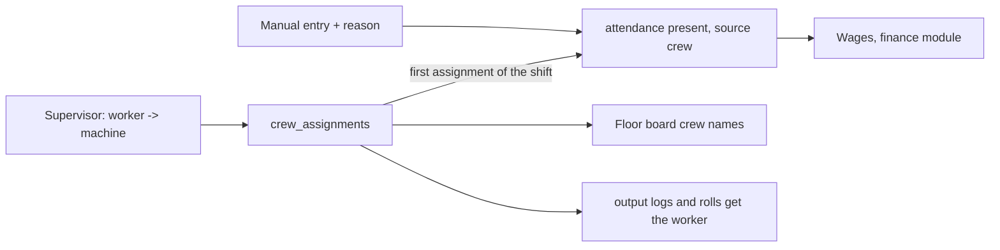

# Workforce module

Owner: Muaz. Code: `backend/app/modules/workforce/`, `frontend/src/features/workforce/`,
page `/floor/crew`. Requirements R9 (shifts and workers on machines) and the attendance half of
R20 (wages are Ashil's).

## What it does

- At shift start the supervisor puts workers on machines (`crew_assignments`).
- Moving a worker closes the old assignment and opens a new one.
- Every assignment writes the day's attendance row (`present`, source `crew`) once.
- Staff off the machines, and corrections, go through a manual attendance entry with a reason.
- `current_shift(at)` tells any module which shift and shift date a moment belongs to.

## Data flow

## Endpoints

| Route | Who | What |
|---|---|---|
| `GET /api/workforce/current-shift` | supervisor, accounts | shift and shift date now |
| `GET /api/workforce/crew?date=&shift_id=` | supervisor, accounts | assignments of one shift |
| `POST /api/workforce/crew` | supervisor | assign or move a worker |
| `POST /api/workforce/crew/{id}/end` | supervisor | take a worker off a machine |
| `GET /api/workforce/attendance?date=&shift_id=` | supervisor, accounts | paged list |
| `PUT /api/workforce/attendance` | supervisor | manual entry or correction, reason required |

## Invariants and how each is enforced

| Rule | Where |
|---|---|
| One attendance row per date + shift + worker | DB UNIQUE, service upsert |
| A worker is on one machine at a time in a shift | `assign_crew` closes the open assignment first |
| Assignment end after start | DB CHECK `to_after_from` |
| No attendance or crew for a future date | Pydantic `PastDate` validator, 422 on `date` |
| Manual entries leave a reason | `AttendanceIn.reason` required, stored in `audit_log` |
| On a machine means present | crew assignment turns a manual `absent` into `present` |
| A day inside a final or paid wage run is locked: no attendance or crew change | `_payroll_open`, 409 `wages_final` |

## DSA used and why

- **Shift lookup with a midnight wrap.** Shift C runs 22:00 to 06:00. If start < end the shift
  covers `start <= t < end`; otherwise it covers `t >= start` (same date) or `t < end` (the shift
  started the day before). IST is a fixed +05:30 offset, so no time-zone library is needed.
- **Interval lookup** for "who was on this machine at time t": the latest assignment with
  `from_at <= t` and (`to_at` empty or `to_at > t`). Used to stamp output logs and rolls with the
  worker without anyone typing it.

## Questions an evaluator is likely to ask

1. **Why is attendance not typed every day?** It is a by-product of crew assignment, the fact the
   supervisor enters anyway. Manual entry exists only for staff off the machines and corrections.
2. **How do you handle the night shift?** It belongs to the date it started. `current_shift`
   returns yesterday's date between 00:00 and 06:00.
3. **What if a worker moves mid-shift?** The old assignment gets `to_at`, a new one starts. Output
   and rolls after the move carry the new machine's worker.
4. **Can the same worker be marked twice?** No. The DB UNIQUE on date + shift + worker stops it;
   the service updates the one row.
5. **Who can see attendance?** Supervisor and accounts (for wages). Only the supervisor writes.
